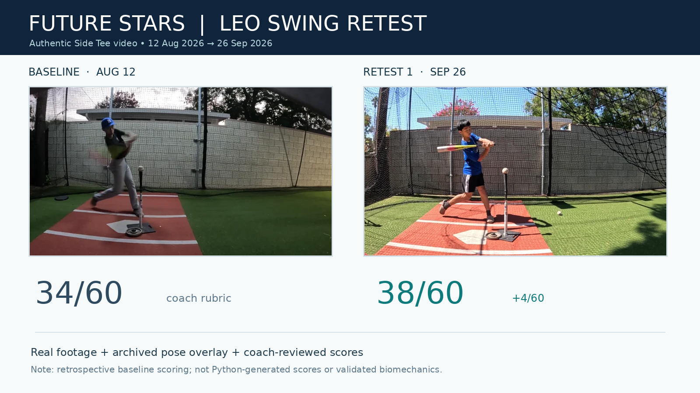

# Future Stars Youth Hitting Analysis

A student-led, low-cost project exploring how ordinary home video can help young baseball players understand and improve their swings.

**Project lead:** Vincent Hall, founder of Future Stars Baseball Club

**Public code:** Python, MediaPipe Pose, OpenCV

**Project website:** [Coaching-to-coding overview](https://www.futurestarsbaseballclub.org/ai-analysis.html)

## At a glance

The project connects a human-led coaching and retesting method with an experimental Python tool for selected 2D movement measurements. The public prototype is not a validated biomechanics system or a fully automated coaching application.

| Part | What is available now | Evidence and limits |
| --- | --- | --- |
| Video review and retesting | Documented family workflow with one or two practice priorities | Human-led coaching process |
| Six-category coaching rubric | A documented review guide | Not an automated or scientifically calibrated score |
| 2D pose overlay and measurements | Body landmarks; knee/elbow angles; shoulder/hip line bearings; torso lean | Implemented in the public script; real-swing accuracy has not been validated by the public tests |
| Annotated video and CSV | Frame-level measurements for each processed video | Timing corresponds to that video's frame index and reported frame rate; no cross-camera synchronization |
| Side/Back and Tee/Toss review | Separately recorded views compared manually | No view synchronization or fusion in the public script |
| Contact detection, automatic six-category scoring, AI reports | Not implemented in the public V3 script | Workflow documentation is not an implemented service |
| Software verification | Synthetic geometry, mocked landmarks, and a non-person model smoke test | These checks do not establish real-swing measurement accuracy or coaching benefit |

**Evidence you can inspect:** [source code](src/process_hitting_video.py), [documented release checks](docs/release_checks.md), and [synthetic sample CSV](data/sample_telemetry.csv). The CSV illustrates a proposed schema; it is not output from a real swing or a demonstration of automatic event detection. A reproducible real-swing run of this public script has not yet been published. The separately labeled coaching case study below uses real footage and report-based scores.

## Real coaching case study: Leo

[](https://www.futurestarsbaseballclub.org/leo-coaching-demo/)

**[Watch the interactive case study](https://www.futurestarsbaseballclub.org/leo-coaching-demo/)** · [Source notes and local viewing](examples/leo-coaching-demo/README.md)

Selected side-tee clips compare August 12 and September 26, 2026. The report's six-category rating changes from **34/60 to 38/60**; the baseline was scored retrospectively. This is a human-reviewed coaching case, not automatic scoring or proof of a training effect. The archived pose-overlay clip has an unverified runtime version and is not a reproduced run of this public script. Published with Leo's family's authorization; the media is not covered by the code's MIT license.

## Start here for families

Start with the one-page, no-code family guide. A phone, a safe practice space, and an adult are enough for the basic record-and-retest loop; the Python prototype is optional.

- [English checklist](docs/family_swing_checklist.md) | [Print the one-page English PDF](docs/Future_Stars_Family_Swing_Checklist_EN.pdf)

The guide covers safe camera placement, tee or adult toss, choosing one cue, repeatable retesting, and optional AI assistance with a person reviewing the evidence.

## Why this project exists

Future Stars began with a practical coaching problem: young players are often told what to change, but it is hard for them to see whether the movement actually changed. We started with simple video review and retesting. Phase II now explores whether ordinary Side/Back, Tee/Toss video can also produce simple, repeatable movement measurements.

The goal is not to build a "perfect swing" model. The goal is to create a method that is affordable, understandable, repeatable, and honest about its limits.

## What we have done so far

### Phase I - video coaching + retest
- As of the October 21, 2026 project-record review: 12 youth-player profiles and 7 with a documented baseline-to-retest comparison. These are coaching-record counts, not a software-validation sample.
- Translations and alternate report versions are not additional players or retests. Vincent’s self-analysis is separate from the 12 youth profiles.
- We used a six-category scoring rubric.
- Players received one or two practice priorities, then recorded again later.

### Phase I practical output: Family Guide & AI Report Rules


Phase I produced a reusable family recording workflow and rules for evidence-based AI report drafts. Read [the full family guide and AI report rules](docs/phase_i_family_guide.md), or download [the editable two-page Word guide](docs/Future_Stars_Family_Guide_AI_Report_Rules_EN.docx). Use it alongside the [current safety and privacy checklist](docs/family_swing_checklist.md).

The protocol uses 8-10 swings at baseline and retest, one safe fixed side view as the minimum, optional additional views, one or two practice targets, and consistent retesting. Its report rules require traceable evidence, the same scoring rubric, clear uncertainty, and human review.

This is a practical methods output. The guide contains no participant scores or measured improvement estimates; it does not independently verify those participation counts or establish a causal training effect. Individual participant records are not included in this public starter.

### Phase II - movement data from ordinary video
The public Python script:
1. Uses the off-the-shelf MediaPipe Pose detector to estimate body landmarks.
2. Calculates selected **2D image-plane** movement measurements.
3. Exports annotated video and a corresponding frame-level CSV for each input video.

In the coaching workflow, Vincent compares separately recorded Side/Back and Tee/Toss views manually. The public script does not synchronize or fuse views. AI tools may help organize evidence and draft reports outside this script; Vincent reviews the evidence and selects one or two training priorities before the player practices and retests.

## Public Python Prototype vs. Local Coaching App

This repository contains the experimental **V3 Python measurement prototype**. The separately developed local coaching app has its own versions and testing process; it is not the same product or a packaged release of this repository.

The [app status page](https://www.futurestarsbaseballclub.org/app.html) describes that separate work. App features, screenshots, and test results must not be treated as evidence of what this public script implements. No app binary or app feature validation is included here. See [AI-assisted analysis boundaries](docs/ai_assisted_analysis.md).

## Simple project loop

**Record the Swing -> Watch & Compare -> Pick One Thing -> Practice a Change -> Record Again -> See What Changed**

## Important honesty about the current system

- MediaPipe is an off-the-shelf pose detector. We did not train it.
- Current joint/tilt values are 2D image-based measurements, not lab-grade 3D biomechanics.
- Reference ranges are context, not universal youth standards.
- AI-generated explanations are hypotheses unless they are directly supported by video/data.
- The telemetry sample is synthetic. The separately labeled Leo coaching case contains family-authorized footage and report-based scores; it is not a code-validation dataset.
- "Not enough information" is an acceptable result.

## Prototype status and local use

This is the original V3 prototype with limited public-release corrections. It is not a validated model. The four-view comparison, six-category rubric, AI draft review, and retest loop are a human-guided method; the script does not automate those steps.

**Legacy runtime:** the script uses `mp.solutions.pose`, which current MediaPipe packages no longer expose. This starter pins MediaPipe 0.10.21 and the direct dependencies used in a Python 3.12.14 Linux smoke test. It remains a legacy prototype. See [limitations](docs/limitations.md) and [release checks](docs/release_checks.md).

Use Python 3.12 in a fresh virtual environment. From the repository root:

```sh
python3.12 -m venv .venv
source .venv/bin/activate
python -m pip install -r requirements.txt
python src/process_hitting_video.py --input path/to/your_video.mp4 --output_dir ./analyzed_output
```

On Windows, activate with `.venv\Scripts\activate` instead. MediaPipe may download its Heavy pose model on first use; model weights are not included in this repository. The notebook does not automatically fetch the repository into Colab.

The script writes annotated video and frame-level CSV files. These outputs retain participant information and require specific publication permission before sharing. The annotated video is not anonymized by adding a skeleton overlay. The Leo case includes selected authorized clips; no corresponding reproducible public-script run or CSV is claimed.

For a data-only example, inspect [the synthetic CSV](data/sample_telemetry.csv). Its event labels and identifiers illustrate a proposed review schema; they are not emitted by the current script. See [telemetry schema](docs/telemetry_schema.md).

## Repository map

```text
docs/
  recording_protocol.md
  measurement_method.md
  scoring_rubric.md
  ai_assisted_analysis.md
  limitations.md
  research_questions.md
  privacy_and_youth_data.md
src/
  process_hitting_video.py
notebooks/
  demo_pipeline.ipynb
data/
  sample_telemetry.csv
examples/
  README.md
PROJECT_LOG.md
CONTRIBUTING.md
DATA_POLICY.md
LICENSE
```

## What we are working on next

- Event labels: Stance, Load, Foot Plant, Launch, Contact, Extension, Finish
- Camera-placement error testing
- Measurement repeatability
- Occlusion / missing-landmark handling
- Multi-view comparison rules
- Retest-based evaluation of practice changes

## Open questions

We do not have final answers yet. That is part of the project.

See [docs/research_questions.md](docs/research_questions.md).

## Contributing

We welcome practical criticism and reproducible suggestions. Please open an Issue if you have ideas about camera setup, measurement error, event definitions, youth-friendly reporting, or how to test whether a training change actually helped.

## Software checks

Run `python -m unittest discover -s tests -v` after installing the pinned requirements. The tests use synthetic geometry and mocked pose landmarks; they do not validate youth swing measurements or coaching outcomes.

## License and dependencies

The project source and documentation carry the included MIT license. Dependencies and separately downloaded model weights retain their own upstream licenses and terms; see [dependency notes](docs/dependencies.md). This repository grants no rights to participant data or third-party media.
